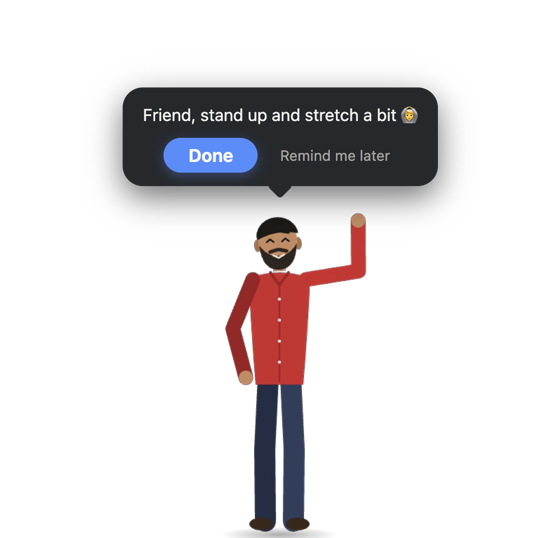
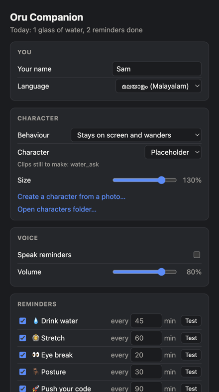
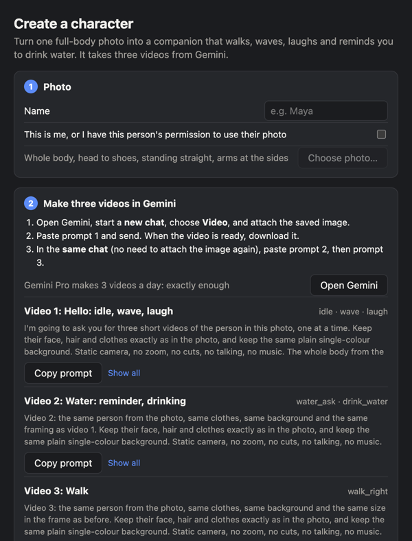

# Oru Companion

A little person who lives on your desktop and looks after you. Every so often they walk in
from the side of the screen, remind you to **drink water**, **stretch**, **rest your eyes**,
**sit up straight** or **push your code**, and walk off again once you answer.

You can turn **yourself** (or anyone who says yes) into the companion with one photo and three
AI videos.

<p align="center"></p>

---

## What you need

- **A Mac**, or Windows if you only want the companion. Making your own character needs a Mac.
- **Node.js**: download the **LTS** version from [nodejs.org](https://nodejs.org) and install it.
- **Git**: on a Mac, open Terminal and type `git --version`; if it isn't installed, macOS offers to
  install it.
- *Only for your own character:* a **Gemini** account that can make videos (Gemini Pro makes
  3 videos a day, which is exactly enough).

## Step 1: Install and start

Open **Terminal** (press `⌘ Space`, type *Terminal*, press Enter) and paste these lines one at a time:

```sh
git clone https://github.com/jasimcm/our-fav-emote.git
cd our-fav-emote
npm install
npm start
```

A character walks in, says hi, and walks off. 🎉

Look for the small **person icon in the menu bar** at the top of the screen (on Windows, in the
tray by the clock). Everything is in that menu.

> Next time, to start it again: open Terminal, run `cd our-fav-emote`, then `npm start`.

## Step 2: Make it yours

Menu bar icon → **Reminder settings…**

- **Your name**, so the bubble says *"Maya, time to drink some water!"*
- **Language**: English or Malayalam
- **Behaviour**: *walks in for reminders, then leaves* (default) or *stays on screen and wanders*
- **Reminders**: turn each one on or off and set how often. Press **Test** to see it now.
- **Size**, **voice** and **start when I log in**

<p align="center"></p>

## Step 3: Turn yourself into the companion (Mac)

Menu bar icon → **Create a character from a photo…**

<p align="center"></p>

**1. Choose a photo.** Type a name, tick the permission box, and pick a photo. For the best
result, the photo should show:
- your **whole body from head to shoes**, with nothing cut off
- you **standing straight, arms relaxed at your sides**, facing the camera
- good light, and nobody else in the photo

The app removes the background and gives you a clean image. Press **Save image…**

**2. Make three videos in Gemini, all in one chat.**
1. Press **Open Gemini**, start a **new chat**, choose **Video**, and attach the saved image.
2. Press **Copy prompt** under *Video 1*, paste it into Gemini, and send. When the video is ready,
   **download** it.
3. In the **same chat** (don't attach the image again), copy and send *Video 2*, then *Video 3*.
   Download each one.

**3. Add the videos.** Drop each video onto its row (or press **Choose…**), then press
**Create character**. After a minute or two you see a preview of every move. Press
**Use this character**. That's you on your desktop now. 👋

## If something looks wrong

| Problem | What to do |
| --- | --- |
| No character on the screen | The default behaviour only shows them for reminders. Use menu → **Remind me now** to call them. Also check the menu doesn't say **Resume** (paused). |
| The app says the feet or head are cut off | Use a photo with your whole body in it, from head to shoes. |
| A move looks wrong in the preview, e.g. the wave is cut short | Ask Gemini for that video again in the same chat, then press **Create character** again. |
| The character slides or walks oddly | Regenerate video 3 (the walk). It needs a side view, walking in place. |
| Want to stop it | Menu → **Quit**. |

## Privacy

Everything runs on your own computer. The app never uploads your photo or videos: you take the
prepared image to Gemini yourself, and the videos you bring back are processed locally. Only use
photos of yourself, or of people who agreed to it.

## More

- [docs/CHARACTERS.md](docs/CHARACTERS.md): how characters work, making one by hand, and how the
  photo creator works.
- [docs/DEVELOPMENT.md](docs/DEVELOPMENT.md): scripts, tests, building the app, and the project layout.

## Licence

MIT, see [LICENSE](LICENSE). The bundled ffmpeg binary (via
[`ffmpeg-static`](https://github.com/eugeneware/ffmpeg-static)) is licensed under the GPL, so take
that into account if you distribute builds of the app.
